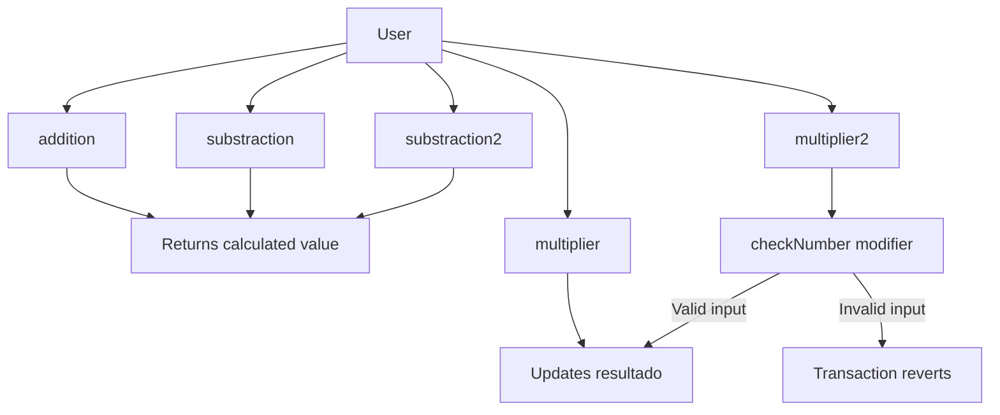

# <h1 align="center"> Solidity Calculator </h1>

This repository contains a simple calculator developed in Solidity as a learning project to practice the language fundamentals and the basic structure of a Smart Contract.

The main goal is to understand and practice the following Solidity fundamentals:

- Smart Contract structure.
- State variables.
- Signed and unsigned integers.
- Function visibility.
- Function return values.
- `pure` functions.
- Internal functions.
- Modifiers.
- Events.
- State-changing transactions.
- Transaction reverts.
- Contract compilation and deployment with Remix.
- Basic Smart Contract testing through Remix.

The contract is implemented in [`Calculator.sol`](./Calculator.sol).

### System flow

## Remix

The project is compiled, deployed and tested using [Remix IDE](https://remix.ethereum.org/).

Remix is used to practice the complete basic workflow of a Smart Contract:

1. Compile [`Calculadora.sol`](./Calculadora.sol).
2. Deploy the contract.
3. Inspect the initial value of `resultado`.
4. Execute the available public functions.
5. Inspect returned values.
6. Observe how some functions leave the state unchanged.
7. Observe how `multiplier` and `multiplier2` modify `resultado`.
8. Test the `checkNumber` modifier and observe transaction reverts.
9. Inspect emitted events and transaction information.

This allows the contract behavior to be understood directly from the values returned after deployment and after each transaction.
